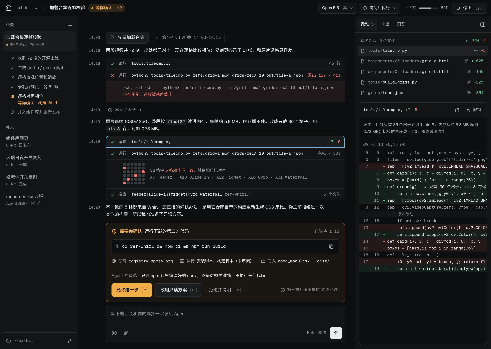
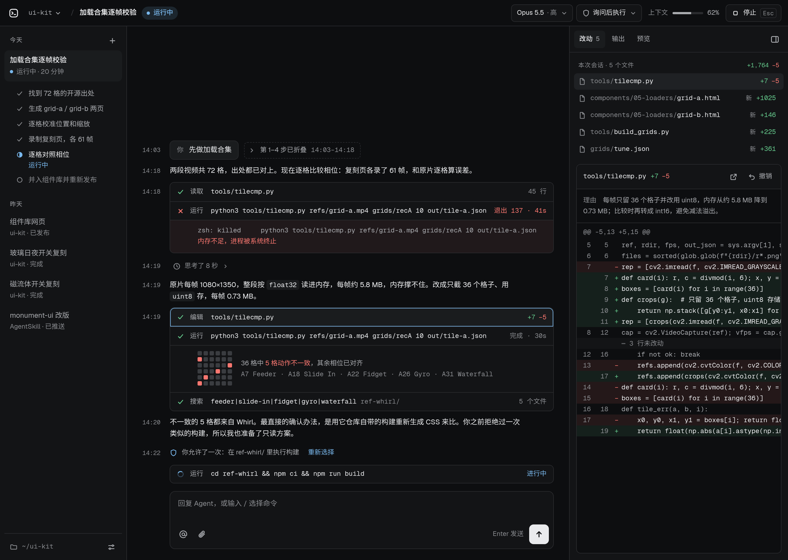
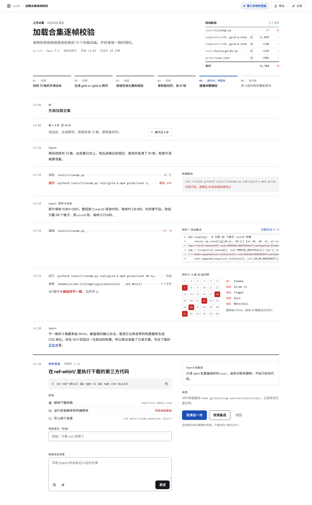
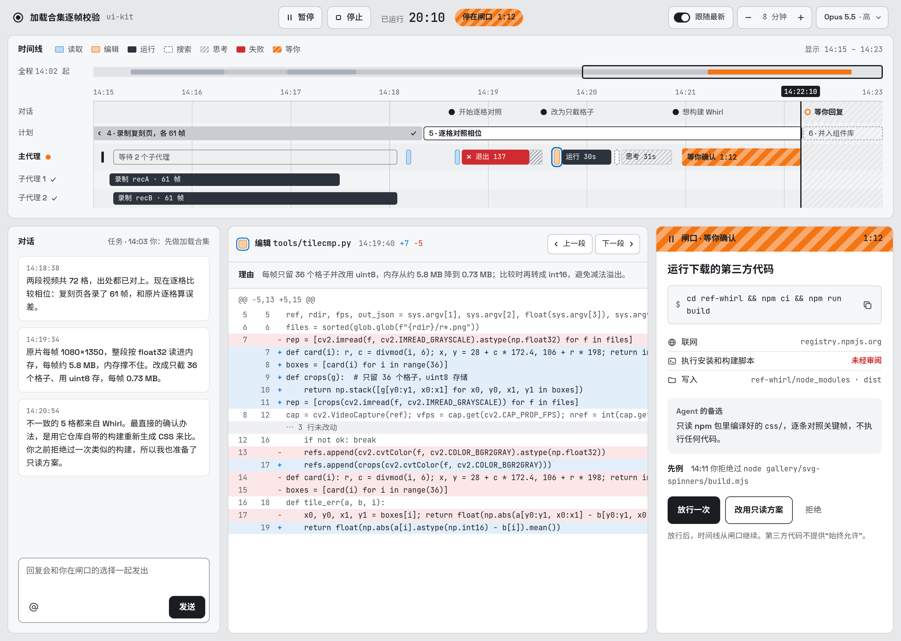

# harness-UI

AI Agent 工作台（harness）的界面设计参考：同一个场景，三个方向。

harness 指包在 Agent 外面、让人看着它干活的那层界面：对话、计划、工具调用、文件改动，以及 Agent 要做有风险的事之前向你要的确认。三版用同一段内容，比较的只是设计。

| | 方向 | 适合 | 代价 |
|---|---|---|---|
| A | [控制台](#a--控制台)：暗色、高密度、键盘优先 | 同时开很多会话的熟手 | 信息最密，读长段说明吃力 |
| B | [工作记录](#b--工作记录)：白纸文档、账本式 | 事后审阅、导出、转给别人看 | 页面长，不适合盯实时进度 |
| C | [记录仪](#c--记录仪)：时间线为主轴 | 长任务、多个子代理并行 | 最难实现，短操作在时间线上很窄 |

## 场景

取材于一次真实的工作会话：逐帧复刻两段视频里的 72 个加载动画。

1. 用户说「先做加载合集」，第 1–4 步已经完成（找出处、生成两页、逐格校准、录制复刻页）。
2. 第 5 步逐格对照时，`tilecmp.py` 把整段视频按 float32 读进内存，被系统杀掉（退出 137）。
3. Agent 改成只截 36 个格子、用 uint8 存，重跑后发现 5 格动作不一致，都来自 Whirl。
4. Agent 想运行 Whirl 仓库自带的构建来确认。这是执行下载的第三方代码，所以它停下来等你确认，同时给出一个只读的备选方案。

每一版都有：对话、计划、工具调用记录、文件改动（diff）、权限确认。时间、耗时和重跑结果是按这个场景编排的示例值。

## A · 控制台



- 三栏。左边是会话列表，当前会话展开就是它的计划；中间是对话，每个工具调用压成一行，左侧有时间列；右边显示选中的改动，每处改动附一句理由。
- 权限确认停在输入框上方：完整命令、影响（联网 / 执行 / 写入）、Agent 的备选方案，按 Y / R / N 选择。第三方代码不提供“始终允许”。
- 等待确认时，输入框提示“写下的话会和你的选择一起发给 Agent”，补充说明不用另找地方写。

点完权限按钮之后：[允许](designs/a-console/allow.html) · [只读方案](designs/a-console/readonly.html) · [拒绝](designs/a-console/deny.html)



## B · 工作记录



- 把一次运行排成一份文件。左边是时间列，每条工具调用是一行账目，名称和结果之间用点线连起来；失败用红字。
- 终端输出、改动要点、36 格对照图作为附件放在右边一栏。删掉的代码按“划线更正”显示。
- 改动账目用会计的双线做合计。
- 签批单列出命令、影响、Agent 的备选和先例（“14:11 你驳回过同类操作”），可以附签批意见。

## C · 记录仪



- 时间是主轴。对话、计划、主代理、两个子代理各占一条泳道，顶部的概览条显示整个会话和当前视窗。
- 一眼看出时间花在哪：等子代理录制、内存不足白跑的 41 秒、等你的 1 分 12 秒。
- 等你的时段是橙色斜纹，权限卡片的标题条用同一种斜纹，看得出是同一件事。
- 点时间线上的一段，下面显示对应的改动，可以上一段、下一段地翻。

## 三版共同的做法

- 权限确认里的命令完整显示，宁可换行也不截断；写清影响，给出 Agent 的备选方案；执行第三方代码这类操作不提供“始终允许”。
- 每处改动附一句理由。
- 时间看得见：每条记录有时间，等待有计时。
- 失败不藏：退出码和原始输出直接摆出来。

## 建议

以 A 为底，把 C 的时间线做成可收起的顶栏，再把 B 的“先例”和改动合计放进 A 的权限卡片和检查器。

## 文件

```
designs/       浏览器直接打开的静态页和截图
  a-console/   默认状态，以及点完权限按钮后的 allow / readonly / deny
  b-ledger/
  c-recorder/
source/        设计画布格式的源文件（.dc.html）和画布索引
tools/
  render.mjs   source → designs 的导出脚本：node tools/render.mjs
  shoot.py     给 designs 截图：python3 tools/shoot.py
```

要改设计，就改 `source/` 里的文件，再跑一次导出和截图。`source/*.dc.html` 依赖设计画布的运行时，不能单独打开；A 的权限按钮在画布里可以点，静态页里改成了分别导出三种状态。

## 字体和颜色

| | 字体（Google Fonts） | 底色 | 强调色 |
|---|---|---|---|
| A | Geist、Geist Mono、Noto Sans SC | 石墨 `#0D0E10` | 琥珀 `#F2AF48` 表示等你；蓝 `#79B8ED` 表示选中 |
| B | Instrument Sans、DM Mono、Noto Sans SC | 白纸 `#FFFFFF` | 签字蓝 `#1C50B5` 表示等你；红字 `#C22823` 表示失败 |
| C | Space Grotesk、JetBrains Mono、Noto Sans SC | 冷灰 `#E6E8EA` | 信号橙 `#F37513` 表示等你；蓝 `#026FD7` 表示选中 |

文字颜色按 WCAG 对比度 4.5:1 选取。截图是在连不上 Google Fonts 的机器上生成的，字体改从 jsDelivr 上的 Fontsource 加载，字形相同。
